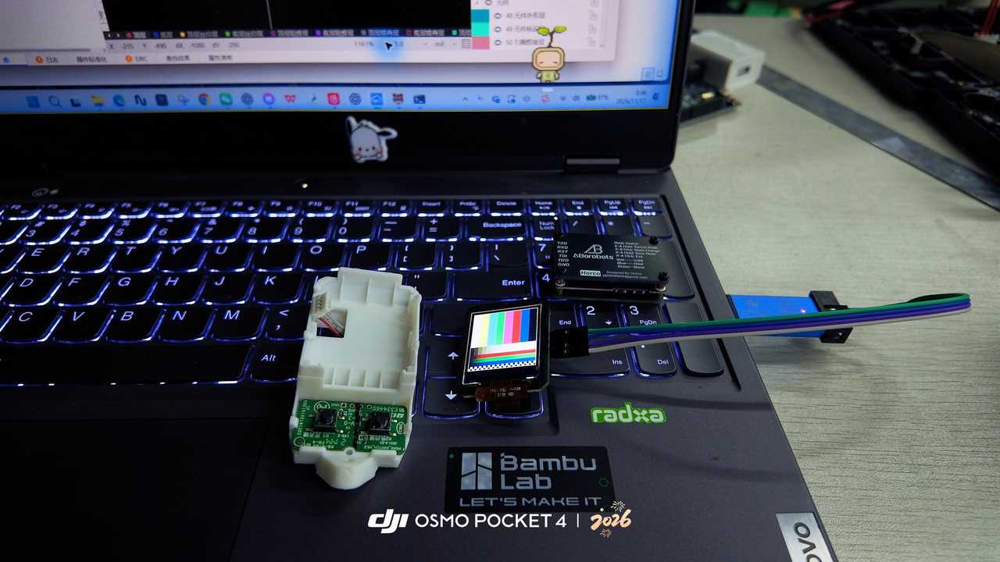

# 捡垃圾小屏点亮：GD32E230 + ST7789

淘宝淘来的 1.3 英寸、240×240 小屏，通过万能 DAPLink 的 SWD 接口读取原固件、分析 GPIO 与屏幕初始化，再显示八色条、灰阶和 RGB 渐变。

项目仓库：https://github.com/jhwi0424/gd32e230-st7789-display

**已点亮，已有实物照片与作者目视确认。当前成功方案在 RAM 中运行，并调用板上原固件的 SPI 发送函数。尚未烧录独立 Flash 程序；断电或复位后需重新加载 RAM 程序。**



## 资料来源与验证范围

| 信息 | 来源 | 本项目的处理 |
|---|---|---|
| 1.3 英寸、240×240、ST7789、24 针屏幕定义 | 淘宝商品详情截图 | 屏幕参数与 FPC 引脚线索 |
| GD32E230C8T6、Cortex-M23 等描述 | 淘宝评价截图；内核类型另经 SWD 验证 | 完整料号不能仅由芯片 ID 读出 |
| CN3 下载口、CN5 外部 Flash 标注 | 淘宝图片上的第三方标注 | 用于寻找接线位置，与 SWD 连通结果交叉核对 |
| PA/PB/PF 用途、SPI 参数、初始化序列 | 本次经 DAPLink 读取原 Flash，再反汇编分析 | 本次分析结果；DAPLink 没有直接返回“管脚定义表” |
| 屏幕已经显示彩条 | 本次实物照片与作者目视确认 | 与淘宝展示图明确区分 |
| 寄存器、显示命令的含义 | GD32 / Sitronix 数据手册 | 解释程序与硬件功能 |

全部图片的原文件名、来源与用途见 [图片与资料来源](docs/sources.md)。函数地址、GPIO 操作证据和初始化参数见 [原固件与管脚分析](docs/hardware-analysis.md)。

## 硬件和 DAPLink 接线

- MCU 料号线索：GD32E230C8T6。读到的 CPUID 与 Cortex-M23 一致。
- 屏幕参数线索：ST7789、240×240、1.3 英寸。已按此初始化出图，未读取到有效 LCD 芯片 ID。
- 模组 PCB：淘宝板图可见 `TFTLCDV1.0` 丝印。
- 本次下载器：万能 DAPLink，CMSIS-DAP v2 / WinUSB，SWD 100 kHz。
- 本机环境：Windows、Python 3、Arm GNU Toolchain。USB 访问用 Windows 自带 SetupAPI / WinUSB，无额外 pip 依赖。
- 脚本针对 WinUSB 的 CMSIS-DAP v2 和 64 字节逻辑包；HID-only DAP v1 不在当前实现范围内。

### CN3 下载口

按淘宝标注板图中 CN3 的图示顺序，从上到下：

| 板上标注 | 连接到 DAPLink | 说明 |
|---|---|---|
| 3.3V / VCC | 目标 3.3 V 电源域对应接点 | 分清下载器的供电输出与电压参考脚，按其定义连接 |
| DAT | SWDIO | GD32 SWD 数据，通常对应 PA13；本次 SWD 已连通 |
| CLK | SWCLK | GD32 SWD 时钟，通常对应 PA14；本次 SWD 已连通 |
| GND | GND | 共地 |

CN5 的 `CLK / DI(DQ0) / DO(DQ1) / CS#` 是淘宝图片标出的外部 Flash 接口，不是 SWD 下载口。CN3 的 CLK、CN5 的 CLK 和屏幕 SPI 时钟不是同一个接口名称。

**电压域要区分：** 淘宝裸屏 FPC 表写 VDD 2.8 V、IOVCC 1.8 V；CN3 板上接入口标的是 3.3 V。不能把下载口的 3.3 V 套用到裸屏的所有电源脚。

### 从原固件分析出的屏幕信号

| 信号 | GD32 引脚 | 依据与状态 |
|---|---|---|
| 背光使能 | PA11，高有效 | 原程序屏幕初始化后置高；成功测试结束也置高 |
| 屏幕 RESET | PA12，低有效 | 原程序高—低—高复位时序；成功方案沿用 |
| 屏幕 CS | PA15，低有效 | 原程序窗口设置前拉低、结束后拉高；成功方案沿用 |
| 屏幕 DC | PB4 | 命令函数清零、数据函数置位；成功方案调用这两个函数 |
| SPI0 SCK | PB3 | 原程序 PB3/PB5 的复用配置；成功方案使用原 SPI0 |
| SPI0 MOSI / SDA | PB5 | 同上 |
| PA0–PA7 | 用途未最终确认 | 原程序设为输出，不能仅凭这点认定为 DB0–DB7 |
| PF6 / PF7 | 用途未最终确认 | 原程序设输出，PF6 低、PF7 高；不能据此认定为供电、WR 或 RD |

前六项由原程序行为和整套点亮实验支持，但未逐条做 PCB 导通测量。淘宝 FPC 序号不能直接替换为 MCU GPIO；完整 24 针表见 [来源说明](docs/sources.md)。

## 基础点屏步骤

### 1. 保留原固件，先读取与备份

接好 CN3 后，在项目根目录运行：

```powershell
python tools/inspect_target.py
```

脚本连接 SWD、读取芯片信息，将完整 64 KiB Flash 保存为本地 `backups/original_flash_64k.bin`。已有备份若与新读取内容不同，脚本拒绝覆盖。

本次读取记录：

| 项目 | 数值 |
|---|---|
| DPIDR | `0x0bf11477` |
| CPUID | `0x411cd200`，Cortex-M23 |
| 调试 ID，地址 `0x40015800` | `0x19090410` |
| 容量信息，地址 `0x1ffff7e0` | `0x00080040`：64 KiB Flash / 8 KiB SRAM |
| 原始向量表 | SP=`0x20000668`，Reset=`0x080000e1` |

原 Flash SHA-256：

```text
5795f431cf1166aabec2453eb476a25913d5f968b5adb61d4613200c1086ceb8
```

本次调试结束后已再次读取全部 Flash 比对，原内容保持不变。完整备份保留本地；公开仓库提供校验值、分析依据与复现代码。

### 2. 直接运行本次点亮的预编译镜像

此步骤只需 Python，不要求安装编译器：

```powershell
python -u tools/run_ram.py --driver factory --image firmware/prebuilt/factory_driver-confirmed.bin
```

脚本先检查原固件 SHA-256，仅在与上述样本完全一致时调用固定地址的原函数。不同固件不能盲目套用本项目的函数地址。

随后执行：

1. 让原程序建立时钟、GPIO 与 SPI 配置。
2. 暂停 CPU，把测试程序写入 SRAM `0x20001000`，回读校验。
3. 设置 RAM 向量表、栈与入口，运行测试。
4. 重新初始化 LCD，设置 240×240 窗口，发送 RGB565 像素，最后开启背光。

整个过程不擦除或编程 Flash。正常输出最后包含：

```text
state 0x50415353 rows 240
```

此状态只证明发送循环完成；屏幕效果还需要目视检查。本项目已有上方实拍。断电、复位或某些探针重连操作会回到原固件，重新执行命令即可再次加载。

### 3. 编译源码

安装支持 Cortex-M23 的 Arm GNU Toolchain，将其 bin 目录加入 PATH，或传入 `-ToolchainBin`。脚本也能查找本机 STM32CubeIDE 2.1.1 自带的工具链。

```powershell
powershell.exe -NoProfile -ExecutionPolicy Bypass -File tools/build.ps1
python -u tools/run_ram.py --driver factory
```

指定工具链：

```powershell
powershell.exe -NoProfile -ExecutionPolicy Bypass -File tools/build.ps1 -ToolchainBin 'D:/ArmGNU/bin'
```

当前源码整理时补充了 SysTick 当前值清零。实拍对应的早期诊断 BIN/ELF 单独保存在 `firmware/prebuilt/`，不随重新编译覆盖。校验值和验证情况见 [验证记录](docs/evidence/validation.json)。

### 4. 图案与初始化

程序使用 RGB565，逐像素发送，不分配完整帧缓冲，适合 8 KiB SRAM。

| 区域 | 图案 | 检查内容 |
|---|---|---|
| y=0…143 | 白、黄、青、绿、品红、红、蓝、黑八色条 | 色序、缺色、大块填充 |
| y=144…175 | 从黑到白的 16 级灰阶 | 灰阶层次 |
| y=176…223 | 红、绿、蓝各 16 行渐变 | 单通道变化与 RGB565 量化 |
| y=224…239 | 黑白棋盘格 | 细节与像素规律 |
| 四周 | 1 像素白边 | 边界与偏移 |

这是基础对色测试图，不宣称完整遵循 SMPTE 广播图规范，也不是仪器色彩校准。照片受白平衡、曝光与拍摄角度影响。

初始化：硬件复位 → `0x11` 退出睡眠 → 原固件电源/帧率/Gamma 参数 → `0x36=0x00` → `0x3a=0x55` 选择 RGB565 → `0x21` 反色 → `0x13` 正常模式 → `0x29` 开显示 → `0x2a/0x2b` 设置 0…239 窗口 → `0x2c` 写像素 → 开背光。

## 构建变体和边界

| 文件 | 加载位置 | 状态 |
|---|---|---|
| `factory_driver.bin` | SRAM `0x20001000` | 默认方案，依赖匹配的原固件，已有点亮实拍 |
| `colorbars_ram.bin` | SRAM `0x20000000` | 独立软件 SPI 实验版本，不作为本次成功证据 |
| `parallel_driver.bin` | SRAM `0x20000000` | 候选并口实验，相关硬件连线未证实 |
| `colorbars_flash.bin` | Flash `0x08000000` | 独立软件 SPI 的 Flash 版本；未烧录、未完成断电自启动验证 |

`tools/flash.py` 是后续独立程序使用的编程工具：按需擦除 1 KiB 页、32 位编程、逐页和全 Flash 回读校验，不改选项字节、OTP 或外部 Flash，且要求明确指定镜像。

**不要把 factory_driver RAM 镜像覆盖到原 Flash，它需要调用仍在原 Flash 中的函数。**

## 文件结构

```text
firmware/main.c             图案、初始化和接口变体
firmware/link.ld            Cortex-M23 链接脚本
firmware/prebuilt/          实拍对应的已点亮 RAM 镜像
tools/build.ps1             编译四种变体
tools/inspect_target.py     SWD 信息读取、原 Flash 备份
tools/run_ram.py            默认运行原固件 SPI 的 RAM 方案
tools/winusb_dap.py         Windows WinUSB / CMSIS-DAP 传输
tools/flash.py              显式指定独立镜像后的 Flash 编程
docs/sources.md             淘宝截图、实拍、手册来源
docs/hardware-analysis.md  函数地址、GPIO 与初始化证据
docs/evidence/              验证记录及校验值
```

本地 build、backups、原始大图与缓存不提交；README 展示图存放在 docs/images。

## 参考资料

- [GD32E230 数据手册](https://www.gd32mcu.com/data/documents/datasheet/GD32E230xx_Datasheet_Rev2.3.pdf)
- [GD32E23x 用户手册：GPIO / RCU / SPI / FMC](https://www.gd32mcu.com/data/documents/userManual/GD32E23x_User_Manual_Rev1.5.pdf)
- [Sitronix ST7789V 数据手册，Espressif 托管副本](https://dl.espressif.com/dl/schematics/ST7789V_SPEC_V1.0.pdf)

淘宝截图与原标注来自第三方，实拍来自本次项目；GPIO 表与复现工具来自本次原固件分析。未把淘宝图片描述为本项目原创原理图，也未把商家描述写成厂家保证。
