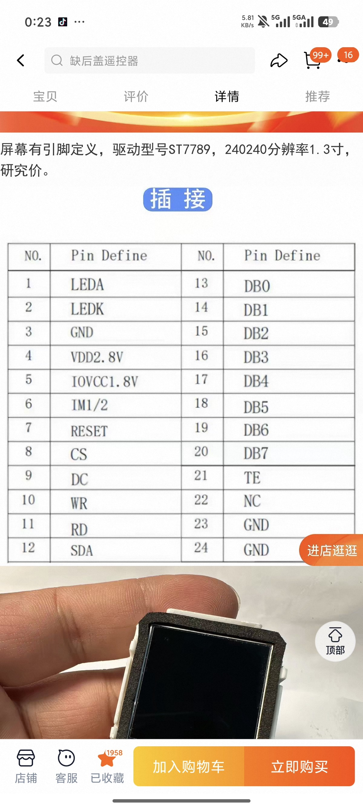
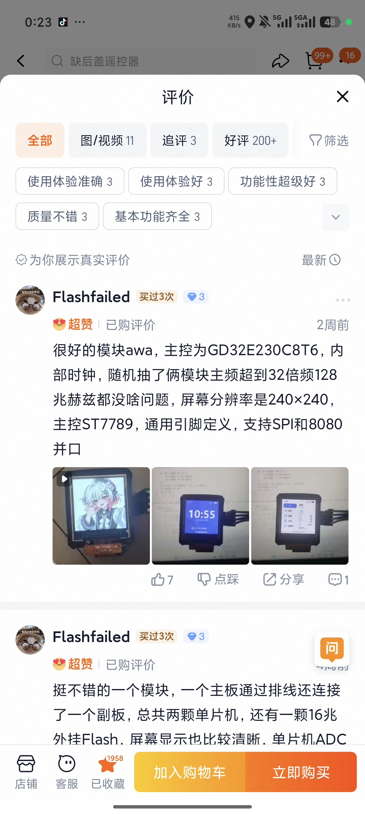
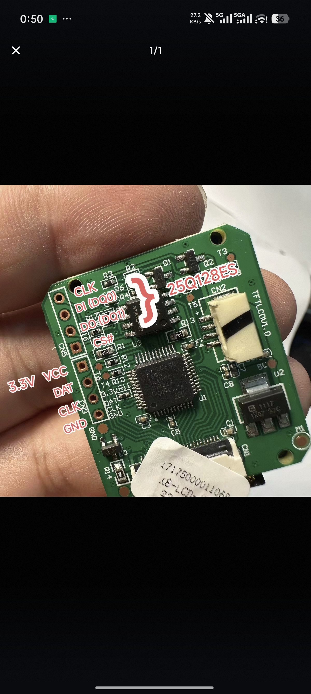
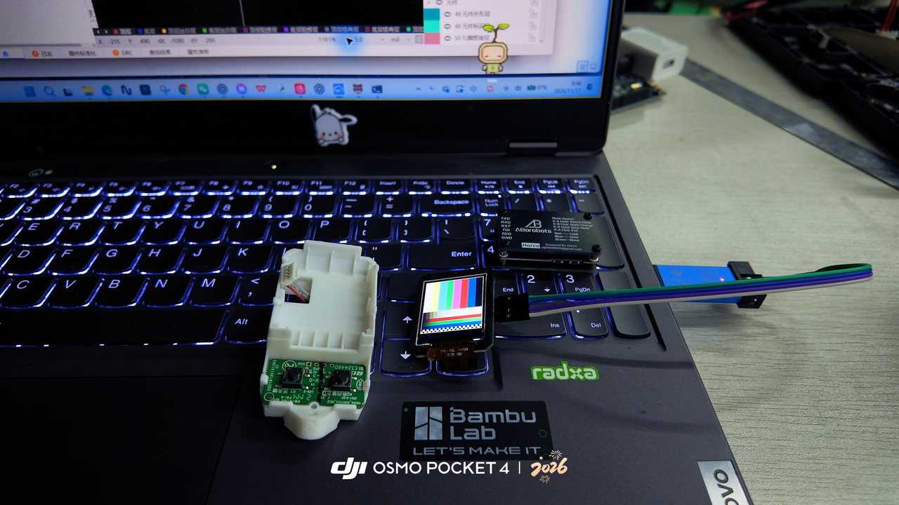

# 图片与资料来源

本项目将淘宝资料线索、本次固件分析和实物验证分别标注。用户明确说明，多张图片来自淘宝截图，不能当作本项目原创资料。

## 图片清单

| 展示文件 | 用户原文件名 | 来源 | 用途 |
|---|---|---|---|
| taobao-panel-pinout.jpg | 18e40f20561a01743b7f79ad6290caf6.jpg | 淘宝商品详情截图 | 1.3 英寸、240×240、ST7789、24 针 FPC 定义 |
| taobao-review-specs.jpg | 78c9ae012e2a28f4974590f4638e7fed.jpg | 淘宝买家评价截图 | GD32E230C8T6 型号、接口和模组结构线索 |
| taobao-board-pinout.jpg | f69238ec9fb8c6a464e93496d124273a.jpg | 淘宝图片截图，带第三方标注 | CN3 下载口、CN5 外部 Flash 接口位置 |
| display-lit.png | img_v3_0217h_da22a77c-ccac-4b48-9bbc-4d789253cadg.jpg | 本次补充的实物点亮照片 | 本次显示结果、模组和 DAPLink 接线记录 |

原图保留在本地。展示副本通过 PhotoCraft 导出：三张淘宝截图保留原画面内容，重新编码 JPEG；实拍缩至 1280×720 PNG。未生成或合成点亮效果，未改变屏幕显示内容。没有可验证的商品链接、店铺名和截图拍摄日期，因此不编造这些信息。

## 淘宝商品详情：裸屏参数与 FPC 定义

截图写有 ST7789、240×240 和 1.3 英寸。下表逐项转录，保留电压与信号名称的原意：

| FPC 序号 | 截图定义 | FPC 序号 | 截图定义 |
|---|---|---|---|
| 1 | LEDA | 13 | DB0 |
| 2 | LEDK | 14 | DB1 |
| 3 | GND | 15 | DB2 |
| 4 | VDD 2.8 V | 16 | DB3 |
| 5 | IOVCC 1.8 V | 17 | DB4 |
| 6 | IM1/2 | 18 | DB5 |
| 7 | RESET | 19 | DB6 |
| 8 | CS | 20 | DB7 |
| 9 | DC | 21 | TE |
| 10 | WR | 22 | NC |
| 11 | RD | 23 | GND |
| 12 | SDA | 24 | GND |

验证范围：

- 这是淘宝给出的裸屏 FPC 定义，不是 DAPLink 直接读取结果，也不是本次逐针测量。
- 屏幕装在 GD32 模组上，板上供电入口、外部 Flash 和 SWD 是另外的接口层次。
- 未做实物 pin 1 的导通定位，不能仅凭截图断言连接器焊盘方向。
- IM1/2 的具体绑带未测量；“支持 SPI/8080”不等于所有板子的默认模式相同。
- 本次通过原固件的 SPI 配置成功出图，但没有因此声称已获得完整 PCB 网表。

## 淘宝评价：型号与其他线索

评价提到 GD32E230C8T6、内部时钟、ST7789、240×240 和 SPI/8080，也提到 128 MHz 超频、两颗 MCU、外部 Flash 等。

本项目将这些内容作为线索，验证范围如下：

- SWD 验证了 Cortex-M23 内核与容量信息，没有仅靠芯片 ID 声称读出完整料号。
- 成功方案使用原固件建立的时钟状态，没有做 128 MHz 超频测试。
- 未识别第二颗 MCU，也未读取外部 Flash 的 JEDEC ID 或完整内容。
- 淘宝评价不能替代芯片厂商的额定频率、电气参数和引脚说明。

## 淘宝板图：下载口与外部 Flash

| 位置 | 原图标注 | 含义及核验范围 |
|---|---|---|
| CN3 | 3.3V/VCC、DAT、CLK、GND | 下载口线索；本次通过 DAT/CLK/GND 成功连通 SWD |
| CN5 | CLK、DI(DQ0)、DO(DQ1)、CS# | 外部串行 Flash 接口线索，不当作 SWD |
| U3 一带 | 25Q128ES | 图片中的器件标注；未做本次 JEDEC ID 核验 |
| PCB | TFTLCDV1.0 | 图上可见的丝印 |

红白接线标注不是本项目原创，也不是 DAPLink 自动生成的接线图。LCD 的 PA/PB/PF 映射来自另一份证据：本次读取原固件后的程序分析。

## 本次实拍：成功显示

照片中能看到屏幕的八色条、灰阶、RGB 渐变及底部棋盘格，旁边有模组、连接线和 DAPLink。作者随后明确确认“已经亮了”。

此照片证明当前 RAM 点屏方案出图，不证明已经烧录独立固件或断电后自动显示，也不能代替仪器色准测量。

## 原厂文档与本次分析

- GD32 数据手册：核对内核、容量、GPIO 复用与 SWD 引脚。
- GD32 用户手册：解释 GPIO、RCU、SPI 和 FMC 寄存器。
- Sitronix ST7789V 手册：解释命令、像素格式和接口选择。
- 原程序内容经本次 DAPLink 从目标读取；仓库记录校验值、函数地址与分析过程。
- 无可验证的淘宝商品 URL，因此只注明截图来源，不虚构店铺、商品链接或原发布者身份。
